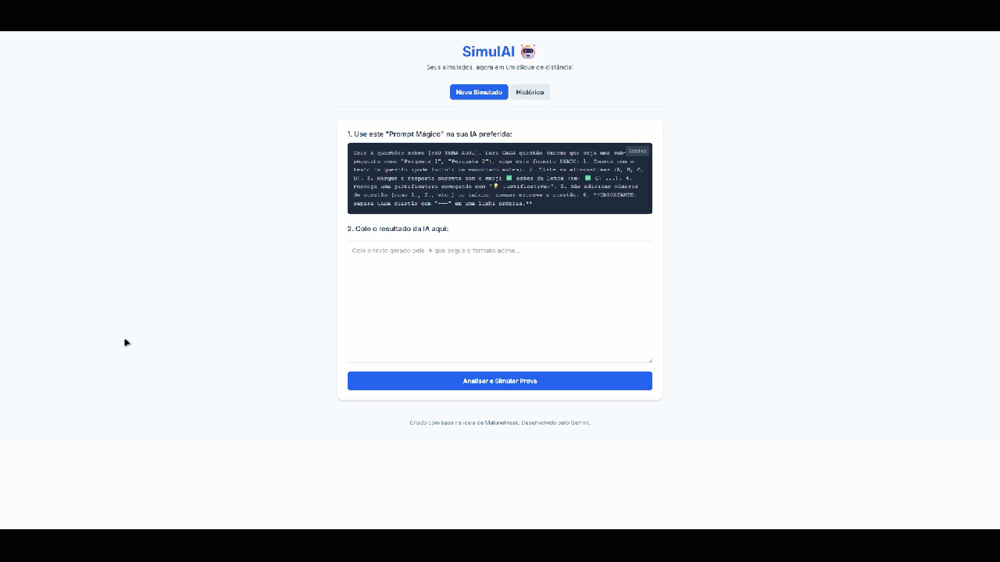

# SimulAI 🤖

> Study smarter. Create, solve, and analyze mock tests generated by any AI instantly.

🌍 **English · Português (BR) · Deutsch** &nbsp;|&nbsp; 🔒 **Offline & private** &nbsp;|&nbsp; 🧮 **LaTeX support**

**[⬇️ Download the latest version](https://github.com/MaloneFreak/SimulAI/releases/latest/download/SimulAI.html)** (a single HTML file, no installation) &nbsp;·&nbsp; [All releases](https://github.com/MaloneFreak/SimulAI/releases)

## About the Project

SimulAI is an **offline-first** web tool that transforms AI-generated text into interactive mock tests. Conceived by MaloneFreak, it solves a common problem for students: creating and grading practice exams quickly.

Ask any AI (ChatGPT, Gemini, Claude, DeepSeek...) for questions on a topic, copy the answer, paste it into SimulAI, and you instantly get a mock test that you can answer, grade and review.


*(Note: the interface may differ slightly in the latest version.)*

## ✨ What's new in v1.3

- **🌍 Multilanguage support (EN / PT / DE).** The interface, the AI prompt, feedback messages and the parsing rules all follow the selected language, and your choice is remembered. Contributed by [@timo2009](https://github.com/timo2009) in [#1](https://github.com/MaloneFreak/SimulAI/pull/1).
- **📦 Single-file release.** One HTML file with everything bundled (styles, math engine, fonts). It works offline, so there is nothing to install and no server to run.
- **🧱 Modular code.** The app is now split into `SimulAI.html`, `src/script.js` and `src/languages.js`, which makes it easier to maintain and to add new languages.
- **🔄 History improvements.** Repeating a past simulation reopens it with a clean answer sheet, and dates and times follow the selected language.

## 🔧 Features

- **🔒 Privacy first.** No servers, no login, no tracking. Everything is processed in your browser and saved in its LocalStorage.
- **🧮 Math & LaTeX.** Great for Engineering and Calculus students. Write math between `$...$` (inline) or `$$...$$` (display), for example $x = \frac{-b \pm \sqrt{\Delta}}{2a}$.
- **⚡ Tolerant parsing engine.** It copes with bold question titles, `---` or `___` separators, options written as `A)`, `A.` or `A-`, and answer and explanation markers in three languages.
- **✅ Instant feedback.** Real-time grading with the explanation for every question.
- **📊 History.** Keeps your last 50 simulations. Repeat a simulation, see its details, delete it, or export everything to JSON as a backup.

## 🚀 Quick Start

### Option A: single file (recommended)

1. Download **`SimulAI.html`** from the [latest release](https://github.com/MaloneFreak/SimulAI/releases/latest).
2. Open it in any modern browser (Chrome, Edge, Firefox, Safari). That's it, it works without an internet connection.

> **Your data stays in your browser.** The history is saved in the browser's LocalStorage, so it is tied to that browser (and possibly to the file's location). Use **History → Export** from time to time to keep a backup.

### Option B: run from source

```bash
git clone https://github.com/MaloneFreak/SimulAI.git
cd SimulAI
```

Open `SimulAI.html` in your browser. Keep the `src/` folder next to it.

This version loads Tailwind CSS, MathJax and Google Fonts from CDNs, so it **needs an internet connection**. If you want to work offline, use Option A, or [build the single file yourself](#-build-the-single-file).

Optionally, you can serve the folder locally:

```bash
# Python 3
python -m http.server 8000
# Go to http://localhost:8000/SimulAI.html
```

## 📖 How to Use

### Step 1: Generate the questions

Pick your language in the dropdown (top left). The prompt box shows the prompt for that language. Click **Copy**, paste it into your favorite AI and replace `[TOPIC]` with your subject.

```text
Create 5 questions about [TOPIC].
Start with one line in the form "Theme: <short topic name>".
Format for EACH question:

Question 1: [Statement]
A) [Text]
B) [Text]
C) [Text]
D) [Text]
✅ [Correct Option]
💡 Explanation: [Reasoning]
---
```

<details>
<summary>Português (BR) and Deutsch prompts</summary>

```text
Crie 5 questões sobre [TEMA].
Comece com uma linha no formato "Tema: <nome curto do tema>".
Formato para CADA questão:

Questão 1: [Enunciado]
A) [Texto]
B) [Texto]
C) [Texto]
D) [Texto]
✅ [Letra Correta]
💡 Justificativa: [Explicação]
---
```

```text
Erstelle 5 Fragen zu [THEMA].
Beginne mit einer Zeile im Format "Thema: <kurzer Themenname>".
Format für JEDE Frage:

Frage 1: [Aussage]
A) [Text]
B) [Text]
C) [Text]
D) [Text]
✅ [Richtige Antwort]
💡 Begründung: [Erklärung]
---
```

</details>

> **Tip:** if you study Math or Physics, ask the AI to write all formulas in LaTeX between `$...$`.

### Step 2: Paste into SimulAI

Copy the entire response from the AI, paste it into the input area and click **GENERATE SIMULATION**.

### Step 3: Take the test

Answer the questions and click **Check**. You will see your score and the explanation for each question. Click **Save to History** to keep the result. The **💾 Save** button at the top of a simulation stores it unanswered, so you can take it later.

### Step 4: Track your progress

Open the **History** tab to repeat a simulation (🔄), see its details (👁️), delete it (🗑️), export everything (📥) or clear it all.

## 🔤 Supported formats

SimulAI looks for these markers. The ✅ and 💡 emojis work in every language, and the rest depends on the selected language:

| Language | Question title | Correct answer | Explanation |
|----------|----------------|----------------|-------------|
| English | `Question 1` | `✅`, `Answer`, `Correct Option` | `💡`, `Explanation:`, `Comment:` |
| Português | `Questão 1` | `✅`, `Gabarito`, `Resposta`, `Letra Correta` | `💡`, `Justificativa:`, `Explicação:`, `Comentário:` |
| Deutsch | `Frage 1` | `✅`, `Antwort`, `Richtige Antwort` | `💡`, `Begründung:`, `Kommentar:` |

Options can use the letters A to E, written as `A)`, `A.` or `A-`. Questions are separated by a line with `---` (or `___`) or by the next question title.

**Topic of a simulation.** The History uses it as the title. SimulAI reads the `Theme:` line (`Tema:` / `Thema:`) that the prompt asks the AI to write at the top. If there is none, it falls back to a sentence like "5 questions about *topic*" before the first question. If neither is found, the title is "Topic not identified" (SimulAI prefers that over guessing a wrong topic).

> If a response doesn't parse correctly, select the same language you used in the prompt and make sure the ✅ and 💡 lines are present.

## 🗂️ Project Structure

```text
SimulAI/
├── SimulAI.html        # Entry point (markup and styles)
├── src/
│   ├── script.js       # Parsing, quiz, grading, history and settings (LocalStorage)
│   └── languages.js    # Texts, prompts and parsing rules for EN / PT / DE
├── data/               # Media used by this README
├── tools/              # Build script for the single-file release
├── LICENSE
└── README.md
```

## 📦 Build the single file

The release asset is generated from the source with a small Node.js script (tested with Node 22). It inlines `src/script.js`, `src/languages.js`, a compiled and minified Tailwind CSS, MathJax (SVG output) and the Inter and JetBrains Mono fonts into one HTML file with no external requests.

```bash
cd tools
npm install
npm run build
# Output: dist/SimulAI.html
```

If you change the structure of `SimulAI.html`, the script stops with a clear error telling you what to update.

## 🌐 Adding a language

1. In `src/languages.js`, copy the `en-EN` block in **both** `content` and `contentDynamic`, rename it to your locale (for example `es-ES`) and translate it.
2. Keep the regular expressions (`regexPatterns`, `regexPatterns2`, `splitPatterns`, `optionRegex`, `questionRegex`, `answerRegex`, `justificationRegex`, `themeRegex`, `themeAboutRegex`) in sync with the words used in your translated `prompt_text`, so the parser recognizes what the AI will write.
3. Add `<option value="es-ES">ES</option>` to the `#language-selector` in `SimulAI.html`.

## 💻 Technologies Used

- **HTML5 & CSS3** (Tailwind CSS)
- **Vanilla JavaScript** (no frameworks)
- **MathJax 3** (renders LaTeX)
- **LocalStorage API** (persists history and settings without a database)

## 🤝 How to Contribute

Contributions make the open-source community an amazing place to learn, inspire and create. Any contribution you make is greatly appreciated.

1. Fork the Project
2. Create your Feature Branch (`git checkout -b feature/AmazingFeature`)
3. Commit your Changes (`git commit -m 'Add some AmazingFeature'`)
4. Push to the Branch (`git push origin feature/AmazingFeature`)
5. Open a Pull Request

## 🙏 Credits

- **[@timo2009](https://github.com/timo2009)**: multilanguage support (EN / PT / DE), language persistence and the modular code structure ([#1](https://github.com/MaloneFreak/SimulAI/pull/1)).

## 📄 License

Distributed under the MIT License. See `LICENSE` for more information.

---

Project conceived by MaloneFreak.
LinkedIn: [Link](https://www.linkedin.com/in/pedro-m-62902b135/)
